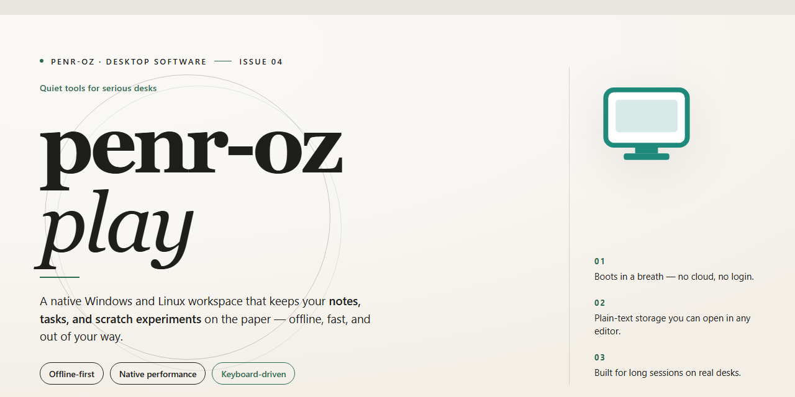

# penr-oz-play REST API Play Framework Docker Windows 10 & 11

### 🚀 PowerShell Quick Install

   

---

penr-oz-play is a REST API implementation built on the Play Framework activator and containerized with Docker for consistent deployment across environments. It combines the Play Framework's routing and request-handling model with Docker-based packaging to streamline both local development and production rollout. The project targets developers who need a reproducible, service-oriented backend scaffold that can be extended with additional endpoints and business logic. Configuration and runtime behavior are organized to support iterative development while maintaining parity between containerized and host-based execution.

## 🔧 Requirements

- Windows 10 or Windows 11
- PowerShell 5.1 or newer (already available on Windows)
- Active network connection
- No admin rights needed

## Features

- Containerized Play Framework runtime: the service ships as a Docker image, providing a reproducible execution environment for the REST API across development, testing, and deployment stages.
- Activator-based project structure: the application follows the Play Framework activator layout, keeping routes, controllers, models, and configuration organized in a conventional, navigable hierarchy.
- RESTful endpoint layer: resources are exposed through Play's routing and controller abstractions, with request handling decoupled from business logic for maintainability.
- Declarative route definition: HTTP verb and path mappings are defined in the route configuration, making the API surface explicit and easy to audit.
- Environment-driven configuration: runtime parameters are supplied through external configuration and environment variables, allowing the same image to target different deployment contexts without modification.
- Isolated dependency management: build dependencies and runtime libraries are resolved within the container image, eliminating host-level toolchain conflicts.
- Self-contained deployment artifact: the Docker image encapsulates the application, its runtime, and its configuration defaults, enabling consistent startup behavior across environments.
- Extensible controller architecture: new endpoints can be introduced by adding routes and controllers without altering the container or build pipeline.
- Local development parity: running the container locally mirrors the production runtime, reducing environment-specific discrepancies during testing.
- Open, versioned project: the codebase is maintained as a standalone repository with a defined version, supporting incremental evolution of the API.

## How it works

The application follows a container-first execution model. The Play Framework activator generates the project scaffold, resolves the Scala and sbt dependencies, and produces a runnable REST API service. All runtime concerns are encapsulated within a Docker image, so the host machine requires only a Docker runtime to build and launch the service.

At build time, the Docker image compiles the Play application and packages the activator output into a self-contained artifact. Route definitions map incoming HTTP requests to controller actions, which in turn invoke the service layer and return JSON responses. The request lifecycle is handled entirely by the Play server embedded in the container, with no external application server required.

At runtime, the container exposes the Play HTTP port and serves the REST endpoints. Configuration is supplied through environment variables and mounted configuration files, allowing the same image to be promoted across environments without rebuilding. Stateless request handling keeps the service horizontally scalable, and container isolation ensures consistent dependency versions between development and deployment.

The layering separates routing, controllers, services, and models so that endpoint behavior can be tested independently of the container runtime. Logging and error handling are centralized, producing structured output that can be collected from the container's standard streams.

## Compatibility

penr-oz-play targets containerized deployment of a Play Framework activator-based REST API. It is designed to run within a Docker environment, with the application packaged so that its runtime dependencies are satisfied by the container image rather than the host system.

Supported deployment configurations include:

- Docker Engine on Linux, macOS, or Windows hosts capable of running the base image.
- Java runtime versions compatible with the Play Framework activator version bundled in the container.
- Standard container networking for exposing the REST API endpoints to clients.

Compatibility considerations:

- The host must support Docker and provide sufficient resources for the Play application container.
- Client integrations should target the REST API contract exposed by the service; consumers are expected to use HTTP clients capable of standard request/response communication.
- The containerized approach isolates the application from host-level environment differences, reducing version drift across development and deployment environments.

For environments where Docker is unavailable, the application can still be run against a compatible Java runtime with the appropriate Play Framework activator setup, though this configuration is not the primary supported path.

## FAQ

- **What is penr-oz-play?** It is a REST API implementation built on the Play Framework activator and packaged to run within Docker. It provides a containerized, reproducible service endpoint suitable for development and integration workflows.

- **What runtime dependencies does penr-oz-play require?** The application targets the Play Framework activator runtime and is distributed as a Docker image. Docker is the primary prerequisite for execution; the JVM and Play dependencies are resolved within the container environment.

- **Which Play Framework version is used?** The service is built against the Play Framework activator toolchain. Version compatibility is determined by the activator configuration bundled with the project.

- **How is the service exposed?** The container publishes the Play HTTP listener so the REST endpoints are reachable from the host. Port mapping is defined in the Docker configuration accompanying the project.

- **Does penr-oz-play support configuration overrides?** Yes. Runtime parameters, including listener settings and environment-specific values, can be supplied through the standard Play configuration mechanisms and Docker environment variables without rebuilding the image.

- **Can the API be extended with additional routes?** The routing layer follows the Play conventions, allowing new endpoints to be declared in the routes definition and handled by corresponding controllers. Rebuild the Docker image to include changes.

- **Is the service stateless?** The REST layer is designed to operate without reliance on in-process session state, enabling horizontal scaling and straightforward container restarts.

- **What response formats are supported?** The API returns structured payloads, with content negotiation handled by the Play stack. Clients should specify the expected media type in request headers.

- **How are errors reported?** Failures are surfaced through standard HTTP status codes accompanied by structured error bodies, allowing clients to distinguish validation, routing, and server-side conditions.

- **Can penr-oz-play be run alongside other services?** Yes. Because it is containerized, it can be composed with additional services on a shared Docker network, with inter-service communication handled over the exposed REST endpoints.

- **How do I verify the service is running?** Query the exposed endpoints once the container is active; a successful response confirms the listener and routing layer are operational.

- **Where are compatibility details documented?** Supported environments, runtime expectations, and version constraints are described in the Compatibility section of this README.

## License

This project is distributed under the Apache License, Version 2.0. The license governs all source code, configuration, container definitions, and documentation contained within the penr-oz-play repository.

Under the terms of this license, you are permitted to:

- Use the software for commercial and non-commercial purposes.
- Modify the source code and create derivative works.
- Distribute original or modified copies of the software.
- Sublicense and incorporate the software into larger applications.
- Receive a perpetual, worldwide, royalty-free grant of rights.

In exchange, the following conditions apply:

- A copy of the license must be included with any distribution of the software or derivative works.
- Modified files must carry prominent notices stating that changes were made.
- All existing copyright, patent, trademark, and attribution notices must be retained.
- Any NOTICE file distributed with the software must be preserved and included in derivative distributions.

The license includes an express grant of patent rights from contributors, along with a patent retaliation clause that terminates the grant for any party initiating patent litigation against the project or its contributors.

The software is provided on an "as is" basis, without warranties or conditions of any kind, whether express or implied, including but not limited to warranties of merchantability, fitness for a particular purpose, and non-infringement. In no event shall the authors, copyright holders, or contributors be liable for any claim, damages, or other liability arising from, out of, or in connection with the software or its use.

Copyright 2017 Derin Works LLC. All rights reserved except as expressly granted under the Apache License, Version 2.0.